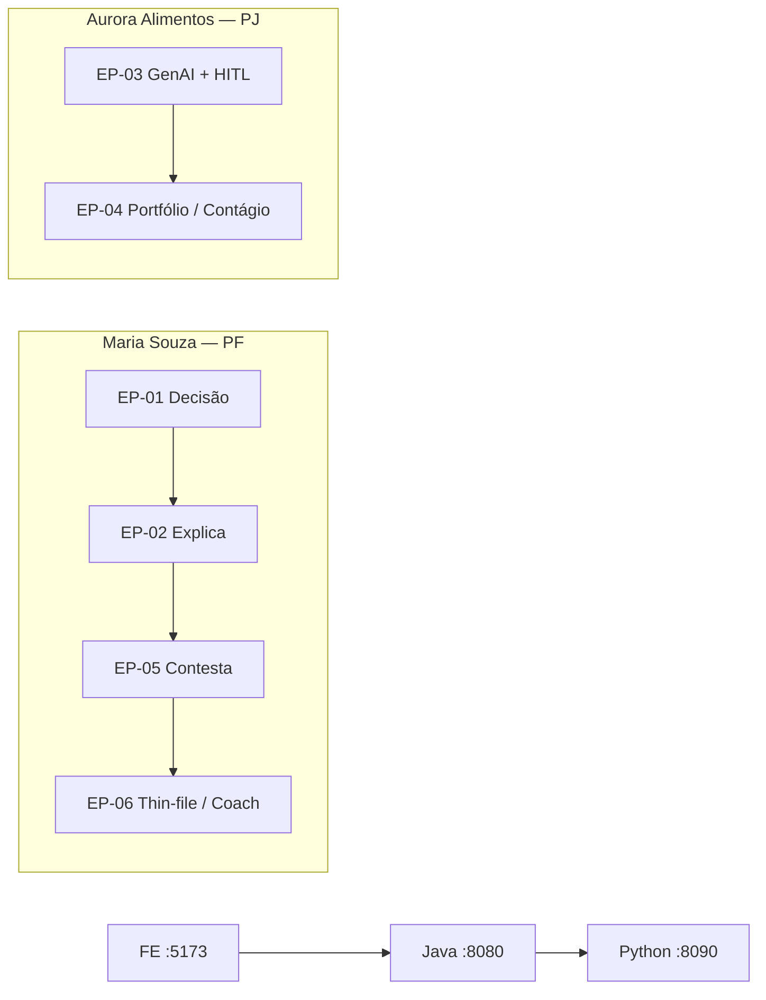

# Jornada QA Completa — EBV Prisma

| Campo | Valor |
|-------|-------|
| **Agente** | QA Master (Solution Center) |
| **Produto** | EBV Prisma · Equifax / BoaVista |
| **Repo** | `Prisma/` (frontend · backend · backend-python) |
| **Data** | 2026-07-29 |
| **Cliente interno** | RodrigoPedrosa |
| **Premissa** | `lab-ready` ≠ `US Done` (OBS-01 / Auditoria Noah) |

---

## 1. Objetivo

Aplicar a jornada de qualidade ponta a ponta no Prisma: Shift-Left → Pirâmide → Riscos → Planos Gherkin → E2E → Massa → Métricas → Smoke/Sanity de release — alinhada às 56 US-BE, ~59 telas FE e ao caminho crítico **Maria** (PF) + **Aurora** (PJ).

## 2. Inventário de baseline (2026-07-29)

| Camada | Stack | Porta | Testes hoje | Lacuna principal |
|--------|-------|------:|------------:|------------------|
| **frontend** | React 18 · Vite 6 · Vitest | 5173 | ~10 arquivos (screens, journeys, a11y) | Sem Playwright E2E live; OIDC produto backlog |
| **backend** | Java 21 · Spring Boot 3 | 8080 | ~55 `*Test.java` (unit + alguns WebMvc) | CTs HTTP por US; E2E infra; OBS-08 |
| **backend-python** | FastAPI · pytest | 8090 | ~7 unit + smoke RAG script | Contrato BFF↔Python; guardrails E2E |

**Veredito baseline:** pirâmide invertida no topo (muitos unit lab) e **base de contrato/E2E insuficiente** para DoD. Superfície REST lab alinhada; comportamento vs RN das US ainda fraco.

## 3. Ordem da jornada (este pacote)

| # | Artefato | Menu QA Master | Arquivo |
|---|----------|----------------|---------|
| 1 | Análise de riscos e priorização | **RA** | [`01_RISK_ANALYSIS.md`](./01_RISK_ANALYSIS.md) |
| 2 | Pirâmide de testes (AS-IS / TO-BE) | **PT** | [`02_TEST_PYRAMID.md`](./02_TEST_PYRAMID.md) |
| 3 | Shift-Left — revisão de critérios | **SL** | [`03_SHIFT_LEFT_REVIEW.md`](./03_SHIFT_LEFT_REVIEW.md) |
| 4 | Planos Gherkin (CTs prioritários) | **TP** | [`04_TEST_PLANS_GHERKIN.md`](./04_TEST_PLANS_GHERKIN.md) |
| 5 | Estratégia E2E | **E2E** | [`05_E2E_STRATEGY.md`](./05_E2E_STRATEGY.md) |
| 6 | Massa de dados | **TD** | [`06_TEST_DATA.md`](./06_TEST_DATA.md) |
| 7 | Métricas de qualidade | **MQ** | [`07_QUALITY_METRICS.md`](./07_QUALITY_METRICS.md) |
| 8 | Smoke / Sanity de release | **SM** | [`08_SMOKE_SANITY.md`](./08_SMOKE_SANITY.md) |

## 4. Escopo de aceite QA (gates)

| Gate | Critério mínimo | Owner |
|------|-----------------|-------|
| **G0 Lab** | Unit CI verde (BE Maven · FE Vitest · PY pytest) | Noah / Sofia / Emilly |
| **G1 Contrato R1** | CTs HTTP OBS-08: EP-01 F04/F05 · EP-03 F04 · EP-05 F01/F02 | Noah (+ Emilly F04 cross) |
| **G2 Jornada demo** | Smoke E2E Maria 20 min + Aurora parecer HITL (live lab) | QA + Sofia |
| **G3 Staging** | OIDC on · 401/403 smoke · header `X-Prisma-Lab` honesto · WORM profile | Noah |
| **G4 DoD US** | Por feature: DoD checklist da US marcado no DEV_RECORD | Escritor + Dev |

## 5. Caminhos críticos de negócio

**Regra de ouro testável:** browser **nunca** chama `:8090` — todo GenAI via BFF Java.

## 6. Agentes da esteira QA (execução)

| Ordem | Agente | Papel |
|------:|--------|-------|
| 0 | **QA Master** | Estratégia, gates, plano, relatório HTML |
| 1 | **GherkinFlow** | BDD HTML+MD Pos/Neg/Reg |
| 2 | **DataForge** | Massa SQL + fixture |
| 3–4 | **Playwright Agent** | Gen specs + run E2E |
| 5 | **Self-Healing Loop** | Só se E2E falhar |
| — | **QA Esteira** | Orquestrador + versionamento |

Piloto executado: **EP-05 F01–F04** · versão **v1-20260729** · relatório:
[`RELATORIO_ESTEIRA_QA_PRISMA_EP05_v1.html`](./RELATORIO_ESTEIRA_QA_PRISMA_EP05_v1.html)

## 7. Próximos passos operacionais

1. Re-run smoke com BE live (`VITE_DATA_MODE=live`) — gate G2 completo.
2. Expandir automação além dos 8 smokes (meta CTs críticos).
3. Rodar checklist [`08_SMOKE_SANITY.md`](./08_SMOKE_SANITY.md) em cada promote lab → staging.
4. Contratos HTTP OBS-08 (Noah) em paralelo à UI.

## 8. Fontes consultadas

- `Prisma/README.md`
- `backend/docs/PLANO_TRABALHO_BACKEND.md` · `RELATORIO_PROGRESSO_BACKEND.md` · `AUDITORIA_US_BE_vs_NOAH.md`
- `frontend/docs/PLANO_TRABALHO_FRONTEND.md` · `DEMO_SCRIPT.md`
- Índices US-BE EP-01…06 · CI `.github/workflows/backend-ci.yml`
